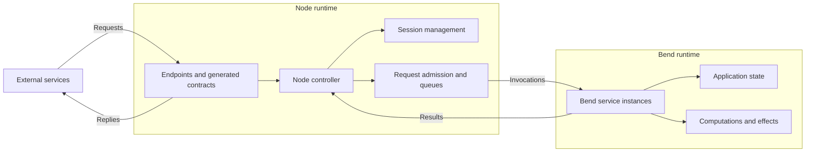
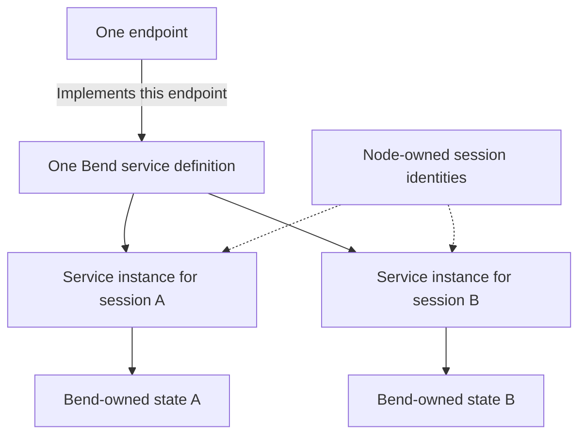
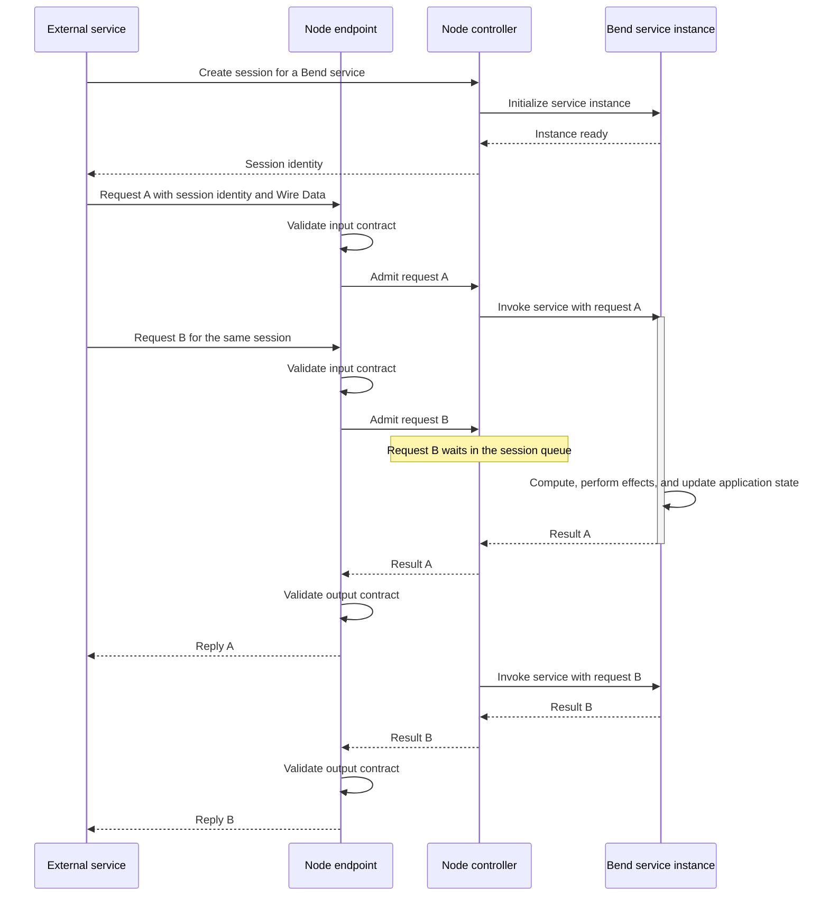
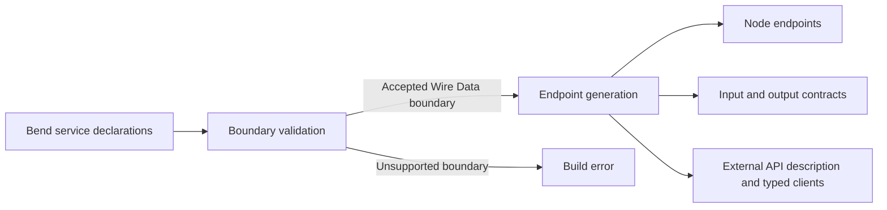
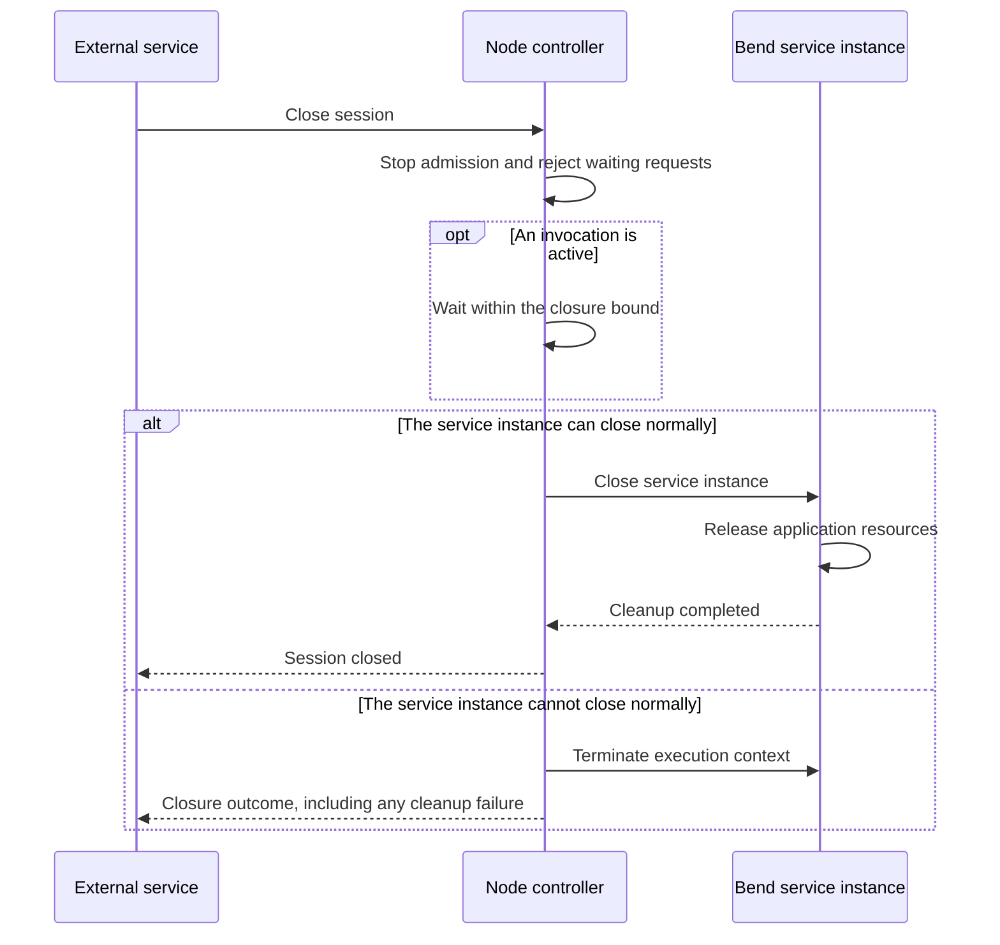

# Desired BendFlow architecture

This document defines the desired architecture, its vocabulary, and its decisions. It does not describe the current implementation or prescribe implementation steps.

The [Phase 3 plan](bend-node-phase3.md) owns the endpoint-generator implementation plan and status. The [Phase 2 reference](bend-node-phase2.md) records the existing system and its verification status.

## Purpose

BendFlow lets you develop a service in Bend, compile it, test it, and iterate on its behavior. An explicit export declaration identifies the Bend functions that external callers can use. A build produces the corresponding Node endpoints, their contracts, and a callable service package.

Bend is the source of truth for service behavior and declared boundary types. Node controls access to the services. BendRT executes their computations and effects and owns their application state.

The external interface does not require a second handwritten definition of the service's inputs and outputs.

## Vocabulary

| Term | Meaning |
| --- | --- |
| Endpoint | A Node URL or route that an external service calls. An endpoint has a generated input contract and output contract. |
| Bend service, or service | An explicitly exported Bend function named with the `api.` prefix. A Bend service implements one endpoint's behavior and may be pure, stateful, or effectful. |
| External service | Code outside BendFlow that calls an endpoint. This includes applications and other network services. |
| Node controller | The Node runtime component that manages endpoints, sessions, request admission, and communication with BendRT. |
| Session | An externally visible identity and lifecycle that associates requests with one retained service instance. Node owns session management. |
| Service instance | A Bend service's execution context for one session. Bend owns the application state and resources in that context. |
| Application state | Values and resources retained by a Bend service between invocations. Application state belongs to BendRT. |
| Invocation | One execution of a Bend service in response to an admitted endpoint request. |
| Contract | The externally observable input, output, and failure rules of an endpoint. |
| Wire Data | Concrete, non-dependent Data with a defined representation across the endpoint boundary. Every nested field must satisfy the same rule. |
| Lifecycle | The creation, use, and closure of a session and its service instance. |

An endpoint is not a Bend function. A Bend service is not an external service. A session identity is not application state.

## Runtime architecture

Node receives external requests, checks their contracts, and associates each request with the correct session. Node then admits an invocation to the corresponding Bend service instance.

Bend executes the service and returns externally representable Data. Node sends the result through the endpoint's output contract.

Node handles the representation of values at the boundary. Node does not implement the service's business rules or maintain a copy of its application state.

## One endpoint maps to one Bend service

Each service endpoint maps to exactly one exported Bend service. The mapping does not select among several business functions at request time.

Session creation and closure are controller operations. They do not introduce additional business services behind a service endpoint.

The endpoint-to-service relationship identifies a definition. Sessions identify instances of that definition. Separate sessions have separate application state, even when they call the same endpoint.

A session belongs to one Bend service. Sharing a session identity between external callers means those callers use the same service instance. Sharing application state between different Bend services is outside this model.

This relationship does not prescribe how executables or operating-system processes are packaged.

## Node controls sessions; Bend controls application state

The Node controller owns endpoint lookup, session identity, session admission, queued requests, and session closure. Node also tracks whether the service instance is available for an invocation.

Bend owns state initialization, state transitions, retained resources, and application cleanup. These operations remain Bend behavior even when Node triggers a lifecycle event.

The controller cannot reconstruct lost application state from a session identity. Cross-session persistence and recovery require an explicit service design.

## Invocations are sequential within a session

Node can receive several requests asynchronously. Each session admits at most one active invocation. Accepted requests for that session wait in admission order until the active invocation finishes.

The order is the controller's admission order, not a guarantee about arrival order across independent network connections.

Different sessions can progress independently. Within an invocation, Bend can use parallel computation and asynchronous effects. Sequential service invocation is a controller policy, not a claim that BendRT is single-threaded or synchronous.

Queues and waiting time are bounded. An unaccepted request does not invoke the Bend service.

### Request sequence

## Contracts come from the Bend boundary

The externally visible arguments and result of each Bend service must be Wire Data. Export validation rejects a service that cannot meet this requirement before producing its endpoint.

Concrete scalar values, records, datatype variants, and collections are eligible when their complete structure has a supported representation and bounded transfer policy.

The boundary excludes unresolved polymorphism, dependent types, proofs, functions, closures, and opaque runtime resources. A Data kind alone does not establish that a value has a suitable external representation.

An effectful service can execute an IO computation that produces Wire Data. The IO computation itself never crosses the endpoint boundary.

Internal state and ordinary Bend helpers are outside the wire-Data restriction. They may use dependent types, affine resources, and other Bend capabilities. Internal state must be explicitly distinct from the externally visible arguments and result.

The generated contract describes the actual external representation. External callers do not need to understand Bend's internal value layout or ownership rules.

Generation is deterministic for the same declarations, policies, and generator version. Endpoint names and contracts do not depend on incidental discovery order. The controller and Bend service must agree on the contract before accepting invocations.

## Closure and failure semantics

Session closure stops new admission and prevents queued requests from becoming new invocations. An active invocation has a bounded opportunity to settle before application cleanup. Forced termination does not promise that application cleanup completes.

An application failure is distinct from a controller or runtime failure. A service can return a declared failure value while remaining usable.

An invocation may perform an external effect before its reply is lost. A missing reply or timeout does not imply rollback. The controller does not automatically replay an invocation whose outcome is uncertain.

Losing the external connection does not prove that the invocation stopped. Session failure invalidates its pending invocations rather than silently recreating application state.

## Decisions and limitations

- Bend owns business behavior, application state, and effects.
- Node owns external endpoints, session management, and request control.
- Each endpoint maps to one Bend service. Each session selects one instance of that service.
- A session executes one invocation at a time. Internal Bend parallelism remains available.
- Explicit Bend exports define the public service boundary. Helpers do not become endpoints implicitly.
- Endpoint inputs and outputs are Wire Data. Internal state does not cross that boundary.
- Transfer limits and queue limits are part of the contract and controller policy. Data declarations alone do not imply finite message sizes.
- Generated contracts must match the deployed service. Deterministic generation does not promise backward compatibility after a contract change.
- Application state is session-scoped. Durable state, recovery after runtime loss, and coordination between services require explicit additional designs.
- Correct boundary types do not prove service behavior, external effects, or execution on a particular device. Those require their own verification.

Exact declaration syntax, serialization formats, numeric limits, scheduling settings, runtime packaging, and device support belong to the implementation plans.
