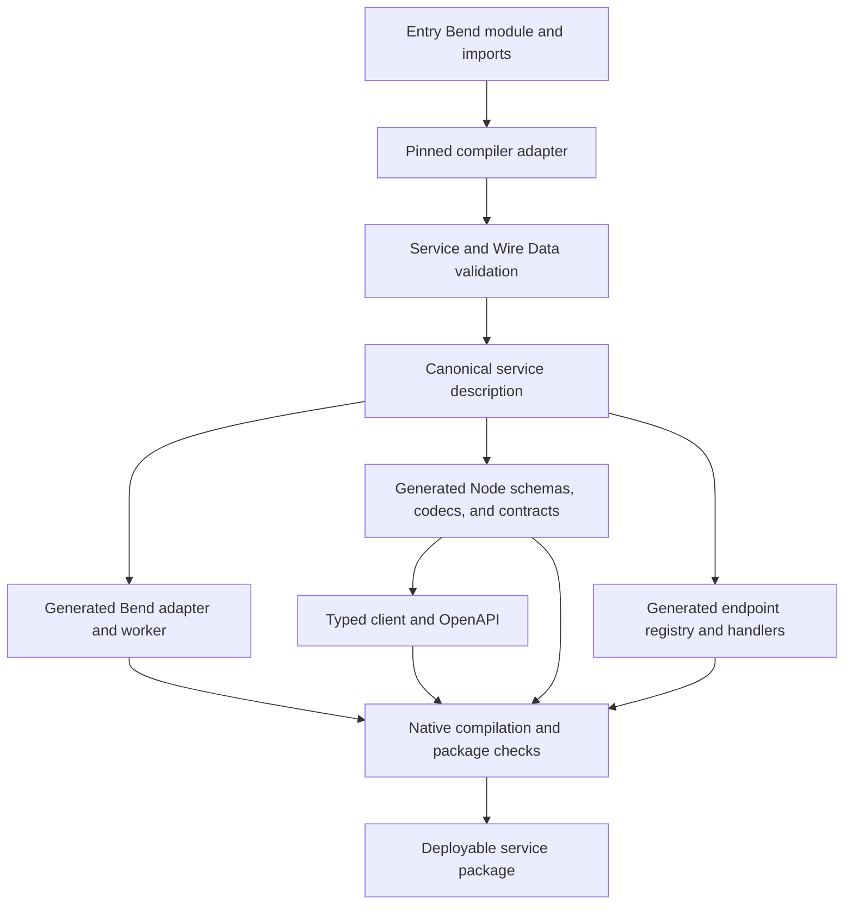

# BendFlow Phase 3: typed endpoint generator

## Status and goal

Phase 3 is in progress. The build command now creates a working, typed Node endpoint from a stateful Bend service. The first tested example is a retained counter. The full generator and deployment system are not complete.

The [desired architecture](architecture.md) owns the architecture and vocabulary. The [Phase 2 reference](bend-node-phase2.md) owns the portable runtime baseline and remaining CUDA acceptance work. Phase 3 does not mark that CUDA work complete.

The goal is a Bend-only service development workflow. You write and test Bend code, export selected `api.*` functions, and run one build command. The build produces native Bend services, Node endpoints, contracts, a typed client, and an external HTTP API description.

No service requires a handwritten Node business handler or a second handwritten definition of its boundary types.

### Current working workflow

You write the Bend service and its initialization and finalization functions in Bend. Run `npm run build:services` to generate the endpoint, its contracts, the client, and the native worker.

Start the generated gateway. An external service creates a session, then calls the endpoint with that session identity. Node checks the request contract and sends an invocation to the Bend service instance. Bend updates application state and returns the reply.

For the counter example, the observable results are:

| Request | Session | Reply |
| --- | --- | --- |
| Add 7 | Session A | `{ value: 7 }` |
| Add 5 | Session A again | `{ value: 12 }` |
| Add 0 | New session B | `{ value: 0 }` |

Bend owns the counter value. Node manages sessions and queues requests. Different external services can use the same session. Separate sessions have separate application state. Each session permits one active invocation at a time.

The generated contracts contain the external request and reply fields. They do not expose internal application state as an endpoint argument.

The current request and reply support is limited to Data records that contain U32 fields. Execution uses the CPU. A second Bend service with different fields verifies that the generator does not depend on counter-specific names or computations.

The full test suite passed 289 tests. The implemented path includes real native workers and HTTP calls. The detailed evidence appears below.

The remaining work includes other Wire Data types, OpenAPI, a standalone deployment package, and integration with the Phase 2 gateway. Those requirements remain partial or planned in the milestone table. The tested counter path is complete; Phase 3 as a whole is not complete.

## Implemented stateful vertical slice

The first slice spans parts of milestones 0 through 8. It is not completion of those milestones' broader acceptance requirements.

`examples/services/counter.bend` contains a retained counter and a weighted accumulator. Both use internal affine State types. Their computations, initial values, and finalizers are Bend code. Adding zero reads the counter, and addition follows U32 wrapping. The counter includes a short IO wait to exercise overlapping requests.

The generator discovers both services and their different request and reply fields without handwritten Node schemas, codecs, or service handlers. An imported `api.hidden` helper does not become an endpoint.

### Accepted declarations

This slice requires a complete entry-module lifecycle triple:

```text
	lifecycle.init.<name>() -> IO(S)
	api.<name>(state: S, request: R) -> IO(S & O)
	lifecycle.finalize.<name>(state: S) -> IO(Unit)
```

The initializer and finalizer authorize the internal first parameter by matching the exact closed state type. Local state datatypes can have closed type arguments, such as `State<U32>`. The parameter's spelling does not authorize state. All callable parameters must be affine, and template parameters are rejected.

The external argument's actual parameter name appears inside `args`. The request and reply must each be a local, monomorphic, single-constructor Data record with 1 through 61 U32 fields. Field declaration order defines native encoding order. The internal State type is not serialized or exposed in the HTTP contract.

The request payload contains four big-endian bytes per field. A successful reply contains a zero tag followed by four bytes per field. The invalid native payload envelope is `[255]`. Native decoding requires exact payload consumption before calling the service. The maximum supported successful reply is 245 bytes, within the existing 248-byte payload bound.

Unsupported exports fail generation. A compiler-valid Type record, unsupported Nat field, dependent function argument, or missing lifecycle definition cannot silently disappear from the API.

Service names must be safe identifiers and must not collide with the controller route or the installed oRPC client's reserved properties. The generator reads the client's reserved-property set from oRPC. Generated runtime imports use namespaces so exports such as `api.validated` and `api.define` do not collide with codec or service-factory names.

### Build and use the slice

Build the supplied example and check the generated client types:

```sh
	npm run build:services
	npm run typecheck
```

The explicit build command accepts another entry file and output directory:

```sh
	npm run build:services -- --entry examples/services/counter.bend --out build/services
```

Start the generated gateway and use a generated client:

```ts
	import { startGateway, createClient } from './build/services/index.ts';

	const gateway = await startGateway();
	const client = createClient(gateway.url);
	try {
	  const session = await client.sessions.create({ service: 'counter' });
	  const reply = await client.counter({
	    sessionId: session.sessionId,
	    args: { request: { amount: 7 } },
	  });
	  // reply has the generated type { value: number } and value 7.
	  await client.sessions.close({ sessionId: session.sessionId });
	} finally {
	  await gateway.close();
	}
```

The generated service routes are `POST /rpc/counter` and `POST /rpc/accumulate`. Controller routes are `POST /rpc/sessions/create` and `POST /rpc/sessions/close`. Raw HTTP callers use the current oRPC envelope, `{ "json": input }`, and receive `{ "json": result }`. Conventional unwrapped JSON and OpenAPI remain milestone 7 work.

### Runtime and build ownership

`src/service-host.ts` owns generated-service sessions and queues. It uses `NativeApp` and launches one CPU worker per session. Each session admits one active invocation, with up to eight waiting invocations by default. Waiting and close-drain limits default to 2000 milliseconds. These limits and worker deadlines are configurable through `startGateway`.

The host rejects expired waiting work without dispatch, drains active work on normal close, and invalidates waiting work after native failure. It does not recreate state or replay calls. Controller-level abort signals remove queued requests. The generated HTTP adapter does not yet connect caller disconnection to those signals.

The generated gateway is separate from the Phase 2 gateway. This design was selected over an immediate eight-kind registry migration to keep the slice focused on native generation and typed invocation. Phase 2 routes, schemas, and GPU admission retain their existing implementation. A later registry migration must resolve this separate controller path rather than require service authors to register functions twice.

`scripts/services/compiler.mjs` isolates the pinned compiler implementation API in a bounded build subprocess. This is compiler interop, not JavaScript execution of service computations. `scripts/services/inspect.ts` validates its serializable output. `scripts/services/emit.ts` derives native adapters and Node code from the checked service description.

`scripts/build/services.ts` copies local source dependencies into staging, checks the staged declarations, generates code, compiles workers, and typechecks generated TypeScript before replacing the output. A rejected generation leaves the preceding complete package intact. Contract identifiers fingerprint the external schema and wire policy. Renaming an internal datatype or constructor does not change that wire contract. Build metadata records hashes of staged source, shared Bend runtime files, and native artifacts.

`npm run typecheck`, `npm run test:types`, and integration or full test selections build the ignored example package before static tests import its generated modules. Generated code is not checked into the repository.

### Acceptance evidence and remaining scope

Focused acceptance lives in `tests/compiler/service-generator.test.ts`, `tests/integration/generated-services.test.ts`, and `tests/types/generated-services.types.ts`.

The focused checks cover actual native calls, retained state, external-process clients, raw HTTP, session isolation, differently shaped services, U32 wrapping, invalid input without mutation, contract mismatch, exact native golden bytes, and finalization followed by process exit. Controller tests cover queue order, capacity, expiry, queued abort, active failure, draining close, and shutdown during startup. Build tests compare generated contracts and source across two builds and verify preservation after rejected generation. Additional native endpoint fixtures verify closed generic state and export names that resemble runtime imports.

The final slice verification run on November 16, 2026 passed `npm test` with 289 tests, zero failures, and zero skips. This includes seven generator tests and nine generated-service integration tests. Generated package and client type checks also passed. `npm run conformance:portable` reported no blockers, and `npm run check:compiler` passed. The executed portable report is `build/phase2-results.json`; it does not constitute full Phase 3 acceptance.

The slice does not establish arbitrary Wire Data support, resource-bearing State cleanup, HTTP disconnect cancellation, application-error unions, GPU execution, a portable standalone package, or OpenAPI. It accepts local imports contained in the entry directory and rejects user-defined foreign effects. Generated TypeScript still imports the repository runtime and installed dependencies. Complete diagnostic source locations and exhaustive lifecycle negative cases remain broader milestone 1 work.

## Existing foundation and gaps

The baseline below describes the Phase 2 foundation that the slice reuses. The Phase 2 reference records its earlier 273-test portable completion run. Current Phase 3 evidence is recorded separately above and in status tracking below.

| Area | Existing implementation | Phase 3 work |
| --- | --- | --- |
| Native lifecycle | `bend/loop.bend` and `bend/transport.bend` provide retained state, framing, handshake, and shutdown. | Generate a service adapter that uses the lifecycle. |
| Native process controller | `src/worker.ts` controls startup, one active call, deadlines, and termination. | Retain its single-call invariant and add a queue above it. |
| Typed native application | `src/app.ts` exposes `NativeApp<Command, Reply>` through an `AppCodec`. | Generate codecs and connect them to service definitions. |
| Session management | `src/apps.ts` owns admission, lookup, startup, and closure. Its factories enumerate eight application kinds. | Support a generated service registry and queued invocations. |
| HTTP contracts and handlers | `contracts/apps.ts` and `src/gateway.ts` explicitly list the existing kinds. | Generate per-service contracts and endpoint handlers. |
| Boundary codecs | Node codecs and Bend decoders and encoders are handwritten per application. | Generate both sides from one checked description. |
| Clients | `src/client.ts` validates replies for the current oRPC contract. | Produce a typed client for the generated endpoints. |
| Builds | `scripts/build/native.ts` uses a clean pinned compiler and an explicit target list. | Add service discovery, generation, native compilation, and packaging. |
| GPU | Phase 2 implements evidence-gated compute admission. Actual device execution and a matching artifact remain unverified. | Preserve the evidence requirement and define generated-service support separately. |

The current `BendWorker.call` rejects overlap with `BUSY`. It does not queue requests. BendRT supports parallel computation and interleaved IO, so sequential invocations are a controller policy.

## Research established before implementation

The pinned toolchain uses Bend 2.0.40 at `f0cf0a7c573145501981c44d9c33e326185f008e`, Node 24, and Bun for the compiler CLI.

The compiler exports declaration loading, checking, and term inspection from `bend2/bend.ts`. Its `Book` contains definitions and datatype constructors. Definitions include declared arity, template-parameter count, a type, and their originating namespace. Constructor types retain field names.

In-memory experiments under Node 24 established the following facts:

- An ordinary `api.*` definition compiles and exposes its checked parameter and return types.
- The compiler exposes a concrete record containing `List<&2, U32>` and its named fields.
- Sorting extracted exports by name produces identical signature descriptions when independent definitions are reordered.
- A comment annotation does not interfere with Bend parsing.
- `@endpoint` is rejected. `@unsafe` is the only accepted decorator.

These experiments establish metadata feasibility. They do not establish a complete codec generator, generated native execution, or arbitrary-type support.

The compiler CLI has no application-signature JSON export. `bend base --types` describes Base. The compiler's TypeScript functions are implementation APIs, so isolate access behind a revision-specific adapter.

Do not use `.mjs` output as the production computation path. That target exports callable non-IO functions for JavaScript execution and does not retain native CPU or GPU execution semantics.

## Scope and decisions

### Agreed architecture

- Use "endpoint" for the Node route and "Bend service" for the exported `api.*` function.
- Generate endpoint types and contracts from the Bend service boundary.
- Map each endpoint to one Bend service.
- Keep application state and effects inside BendRT.
- Keep session management and request admission in Node.
- Execute one invocation at a time within a session and queue accepted overlapping requests.
- Restrict external arguments and results to Wire Data. Internal helpers and retained state are outside that restriction.

### Proposed initial implementation

The following choices describe the broader implementation proposal. The stateful slice has fixed the subset documented above. Milestone 0 must resolve the remaining choices before they become implemented guarantees.

- Select exports with the `api.` prefix in an explicit entry module. Imported helpers are not exports merely because their names contain that prefix.
- Use fixed `POST` routes derived from the exported names. Reject route collisions instead of renaming them silently.
- Give each session one native process for one Bend service. Initially compile one worker executable per Bend service to avoid shared application-state dispatch.
- Use the existing binary frame transport and generate an `AppCodec` for each service.
- Preserve existing scalar and collection bounds for the first delivery. Reject unsupported large boundaries until an explicit transfer extension exists.
- Require explicit session creation and closure for all service categories in the first delivery. A sessionless convenience interface is not required for acceptance.
- Generate conventional JSON HTTP endpoints and OpenAPI alongside the typed oRPC client contract. Reuse the same schemas and invocation handlers.

Executable grouping is a packaging choice, not an endpoint-to-service relationship. Future grouping must preserve one service per session and state isolation.

### Decisions required in milestone 0

| Decision | Required outcome |
| --- | --- |
| Stateful declaration convention | Identify internal state, initialization, transition, and cleanup using valid Bend declarations. Do not infer internal state solely from a parameter's name or kind. |
| Session interface | Fix creation and closure routes, service identity, execution options, and how service endpoints carry a session identity. |
| Route naming | Fix the mapping of export names to HTTP paths and operation identifiers, including reserved controller routes and collision checks. |
| Wire Data support | Fix initial supported types, representation rules, recursive-type policy, and bounds for complete messages. |
| Queue policy | Fix capacity, admission order, waiting deadlines, active deadlines, disconnect behavior, and closure behavior. |
| Generated package layout | Fix entry files, relative native artifact paths, compiler and generator metadata, and runtime dependencies. |
| API adapters | Fix the JSON HTTP representation and the corresponding OpenAPI serializer. The existing oRPC custom byte format must not become an undocumented requirement for non-Node callers. |

## Service declarations and boundary validation

### Pure and effectful services

An ordinary exported definition declares externally visible parameters and a return type. This example uses valid Bend syntax:

```python
	import Base

	def api.add(a: U32, b: U32) -> U32:
	  (a + b : U32)
```

The proposed endpoint receives named arguments and returns the declared result. A session identity is controller metadata, not an argument passed to `api.add`.

An effectful definition can return `IO(Response)` when `Response` passes Wire Data validation. The generated native adapter executes IO and serializes its result. It never serializes an IO action.

### Stateful services

A stateful service needs an explicit internal state role and lifecycle. Its transition has the conceptual type:

$$
step : State \times Request \rightarrow IO(State \times Response)
$$

Only `Request` and `Response` are external values. `State` remains in BendRT and may contain affine resources or dependent structures.

The first slice implements this declaration convention with the explicit lifecycle names documented above:

- `api.<name>` implements the transition and has a declared internal state parameter.
- Paired ordinary Bend definitions identify the initializer and finalizer for the same service.
- The initializer returns the service's exact state type through IO.
- The transition returns the same state type beside a Wire Data result through IO.
- The finalizer consumes that state and returns `IO(Unit)`.

Use an explicit association between these definitions. A matching initializer and finalizer must authorize the internal-state role. Do not hide a `Type` parameter from the contract just because it is the first parameter.

Freeze the exact names and signature forms after a native prototype proves state retention and cleanup. These lifecycle definitions are not additional external endpoints. Pure and effectful services without retained application state can use a generated trivial lifecycle.

### Pre-generation checks

Implement the check before writing endpoint artifacts:

1. Load the entry module and its imports through the pinned compiler.
2. Run the Bend checker and reject incomplete definitions or unresolved holes.
3. Select only filled service definitions explicitly exported from the configured entry module.
4. Read exactly the declared parameter count. Do not treat a function-valued return type as more endpoint parameters.
5. Resolve any explicit lifecycle association and separate internal state from external arguments and results.
6. Recognize IO as an execution wrapper before validating the returned external value.
7. Validate every external type and nested field against the Wire Data rules.
8. Calculate complete encoded request and reply bounds.
9. Validate route uniqueness, service identity, generated names, and lifecycle signatures.
10. Produce a canonical description only after all checks pass.

Reject unresolved type parameters, exported template parameters, dependent boundary types, proofs, functions, closures, and opaque handles. Reject external `Type` values and kind expressions.

Concrete datatype applications can contain erased type and quantity arguments, as `List<&2, U32>` does. Resolve those arguments as compile-time metadata. Do not expose them as HTTP fields. Initially reject user-defined erased proof or payload fields unless an omission rule is explicitly supported.

Follow type references and aliases with a bounded extraction process. Bend types are terms, so blindly normalizing every reference can erase useful distinctions or encounter nonterminating type-level code. Preserve IO recognition and report unsupported type computation rather than hanging the build.

Diagnostics must identify the service, parameter or result, nested field path, source location when available, rejected type, and an actionable reason. An unsupported exported function fails the build rather than disappearing from the generated API.

### Initial representation and bounds

| Bend boundary value | Proposed external representation | Native rule |
| --- | --- | --- |
| `U32` | JSON integer from 0 through $2^{32}-1$ | Four big-endian bytes. |
| `Bool` | JSON boolean | A validated boolean tag. |
| `Nat` | Canonical decimal string | Existing six-byte native range, 0 through $2^{48}-1$. |
| `F32` | An explicitly named bit-pattern representation | Preserve all 32 bits, including NaN and signed zero. Do not silently substitute JSON floating-point numbers. |
| `String` | Well-formed Unicode text | Existing default of 96 UTF-8 bytes, plus encoded field metadata. |
| `Unit` | One documented JSON unit representation | Freeze the representation in milestone 0. |
| Pair | A fixed two-element JSON tuple | Encode in declared order. |
| Single-constructor Data | A strict object with named fields | Preserve field declaration order on the native wire. |
| Multi-constructor Data | A discriminated JSON union | Assign canonical constructor tags and reject unknown tags. |
| Concrete list | A JSON array | Existing default of at most 32 items, subject to the complete message bound. |

The current HTTP body limit is 4096 bytes. The native frame body limit is 256 bytes, leaving a 248-byte application payload. A list-length limit does not imply that a list of nested records fits that payload.

Treat known containers such as lists as bounded wire structures. Initially reject recursive business datatypes unless milestone 0 defines depth and total-node bounds with a provably bounded codec. Arrays and maps remain internal until explicit Data-compatible boundary representations are supported.

The first generator must reject schemas whose maximum request or reply exceeds the payload bound, including tags, lengths, and error envelopes. Check actual encoded sizes at runtime as well.

Existing paging supports specific Phase 2 applications. It is not a generic mechanism for arbitrary exported signatures. Large-result generation needs a separate implementation unit covering capture, retrieval, release, failure, and cleanup. Larger request upload needs its own design.

## Deterministic generation pipeline



Use one serializable description for every generator. The description contains service identity, canonical route, external parameters, result, concrete datatype definitions, bounds, lifecycle association, and protocol version.

Keep compiler terms, closures, absolute source paths, and diagnostic spans out of the canonical contract. Store diagnostics separately. Use relative module identity rather than an import alias as service identity.

Sort services and independently emitted datatype definitions by canonical name. Preserve parameter order and constructor-field order. Define constructor-tag ordering explicitly. Sort output declarations without reordering the original Bend source, whose safe definitions depend on source order.

Fingerprint the canonical contract together with wire-policy and protocol versions. Put the same contract identifier in the generated Node codec and native handshake. A stale Node package must fail before a service invocation.

Record source hashes, generator version, compiler revision, target platform, build commands, and artifact hashes in package metadata. Keep machine observations separate from the canonical endpoint contract.

Generation into a fresh temporary output tree must succeed before replacing published output. Remove stale generated files when exports disappear. A failed check or compile must not leave a mixture of old and new service artifacts.

Determinism means identical generated contracts and source for identical inputs. Native binaries and GPU artifacts remain target-dependent. Sorted numeric tags do not promise backward compatibility when constructors change.

## Implementation milestones

Every milestone ends with runnable acceptance evidence. Several milestones have slice evidence, but none has completed its full acceptance requirements.

### 0. Freeze the service declaration and controller policies

1. Resolve the milestone 0 decisions above.
2. Check representative declarations for a pure service, an IO service, and a stateful service.
3. Prototype the proposed stateful convention against a real native worker, including initialization failure and cleanup.
4. Define a negative declaration with an external dependent type and one with an external resource handle.
5. Record the chosen forms and policies in this document before implementing the generator.

Acceptance requires unambiguous external arguments, internal state, result, and lifecycle roles for each declaration. The prototype must demonstrate that Node never owns application state.

### 1. Build the compiler adapter and checked service description

1. Add a build-only adapter around the pinned `bend2/bend.ts` functions.
2. Enforce the clean compiler revision through `scripts/lib/toolchain.ts`.
3. Load imports, check definitions, select entry-module exports, and extract concrete signatures and datatype fields.
4. Implement Wire Data validation, lifecycle checks, route collision checks, and encoded-size analysis.
5. Emit a serializable canonical description with separate source diagnostics.

Acceptance requires positive fixtures for each supported boundary type and negative fixtures for every rejection rule. Include imported names, closed generic datatypes, nested invalid fields, function-valued results, unresolved templates, and missing lifecycle definitions.

Compare descriptions across repeated runs, independent source reorderings, changed import aliases, and different workspace paths. Only semantically relevant changes may alter contract identity.

### 2. Generate a pure native service and Node codec

1. Generate one Bend adapter for a fixed-size `api.add` service.
2. Import the user's module and call its exported function directly.
3. Generate argument decoding and reply encoding through `bend/bytes.bend` and the shared lifecycle.
4. Generate the Node schema and `AppCodec` from the same description.
5. Compile the adapter into a native worker and invoke it through `NativeApp`.

Use native command operation 1 and shutdown operation 3 from the existing lifecycle. Define the service-specific payload and failure envelope without repurposing transport operations. Bound the contract identifier within the handshake payload limit.

Acceptance requires independent golden bytes, successful native calls, invalid input rejection, exact output validation, contract mismatch rejection, and completed native cleanup. This is the first end-to-end generated computation.

### 3. Complete supported Data codecs and IO execution

1. Generate codecs for the accepted scalar, tuple, record, union, and list forms.
2. Generate bounded malformed-input paths before any user function or effect executes.
3. Generate `IO(Response)` execution and distinguish service-declared failures from infrastructure failures.
4. Enforce complete request and reply bounds on both sides.
5. Produce strict Node schemas and schema-derived TypeScript types.

Acceptance requires native cross-language vectors for nested structures, UTF-8, Nat boundaries, all relevant F32 bit cases, invalid tags, truncation, trailing bytes, and maximum encoded sizes.

Use an externally observed IO fixture to prove that the generated service executes the expected effect. Malformed input must leave the observer unchanged. Successful schema generation alone is not acceptance.

### 4. Generate stateful service adapters and lifecycle

1. Generate initialization, transition invocation, state retention, and shutdown for the frozen lifecycle convention.
2. Keep internal state out of Node schemas, clients, codecs, and external replies.
3. Connect one native process to each service session.
4. Preserve state when a declared application error permits continued use.
5. Fail session creation cleanly when initialization fails.

Acceptance requires a retained counter with independent sessions and an affine-resource service with externally observed cleanup. Verify shared session use by separate external callers, state isolation, close idempotence, startup overlap, and worker-loss behavior.

Inspect the generated contract to prove that state and lifecycle parameters do not appear externally. Run negative fixtures where an undeclared internal-state role would otherwise hide an invalid boundary parameter.

### 5. Replace fixed service registration with generated endpoints

1. Add a generated service descriptor that binds service identity, contract, executable, codecs, and reply validation.
2. Adapt `AppSessions` to use generated service descriptors rather than requiring new handwritten factories for each export.
3. Generate endpoint contracts, route handlers, session-create input, and typed client entry points.
4. Validate session-to-service association before dispatch.
5. Preserve existing Phase 2 routes and tests through the required registry migration, with their implemented behavior explicit.

Acceptance requires adding and removing a Bend export to add and remove an endpoint without edits to Node business code. Verify unknown sessions, wrong-service sessions, duplicate route rejection, malformed HTTP input, and reply validation.

Do not widen the generated client to an untyped string-indexed collection. Known generated endpoints must have their exact input and output types.

### 6. Implement the session invocation queue

1. Add a per-session FIFO admission queue above `NativeApp` and `BendWorker`.
2. Dispatch the next queued invocation after a valid reply, including a declared application failure that leaves the session usable.
3. Bound queue capacity and reject excess requests before native dispatch.
4. Track waiting deadlines separately from active-call deadlines.
5. Reject queued requests when the session fails or starts closure.
6. Allow an active call to settle within a bounded close period, then request Bend cleanup or force termination.

Prefer this initial disconnect policy: remove a queued request if its caller disconnects before dispatch. Do not interpret an active caller disconnect as cancellation or replay authority. Finalize this policy in milestone 0.

A waiting request that expires must never be dispatched. An active deadline makes the session terminal under the existing worker policy. Fail remaining queued requests and do not restart or replay automatically.

Acceptance requires deterministic native or external handshakes that prove invocation order, zero active overlap, capacity rejection, waiting expiration without effects, active failure, disconnect handling, and closure during an active call.

Also prove that a second session can complete work while the first session has a blocked invocation. Tests must observe service behavior rather than rely only on elapsed time or queue internals.

### 7. Expose portable HTTP contracts and clients

1. Add the matching-version oRPC OpenAPI packages and schema conversion support.
2. Bind the generated service handlers to a documented JSON HTTP interface.
3. Generate OpenAPI from the same endpoint schemas and routing metadata.
4. Generate or export the typed Node client through the generated contract.
5. Document exact representations for Nat, F32 bits, unit values, tuples, datatype variants, and errors.
6. Make the gateway bind address configurable for deployment while keeping a local default.

The pinned oRPC 1.16.2 OpenAPI generator supports contracts and routers and emits OpenAPI 3.1.1. Its options differ from current upstream documentation. Use version-matched APIs.

Acceptance requires a raw HTTP caller that does not use the oRPC client and a caller from a non-Node runtime. Both must invoke the generated endpoints and agree with the generated API description.

Check the generated Node client at compile time with accepted calls and rejected wrong argument types, invalid union variants, wrong service identities, and invalid result assumptions.

### 8. Add the one-command build and deployable package

1. Add a CLI that accepts a Bend entry module and output directory.
2. Run extraction, validation, generation, native compilation, and package checks in order.
3. Produce Node runtime entry files, generated contracts, codecs, clients, OpenAPI, native workers, and build metadata.
4. Replace output only after the complete build succeeds.
5. Resolve native executable paths relative to the generated package rather than the BendFlow checkout.
6. Include all imported Bend dependencies and required foreign C dependencies in the build fingerprint and build inputs.

The intended packaged CLI shape is shown below. It is proposed and not available yet. The slice currently uses `npm run build:services`.

```sh
	bendflow build ./services.bend --out ./dist
```

Generated native adapters must use import paths that the pinned loader accepts. Its module-path rules restrict names and imports outside the entry root. Prove generated-directory placement with real imports before freezing package layout.

Acceptance requires building a separate fixture project, moving the produced package outside the repository, starting it, and invoking its services. The deployed Node controller must not need the compiler checkout, Bun, or the original service source to run CPU workers.

Run the build twice and compare generated source and contract bytes. Change and remove exports to prove that stale routes and artifacts disappear. A failed rebuild must leave the previously complete output usable.

### 9. Complete regression and publication acceptance

1. Add an explicit Phase 3 requirement inventory with exact tests and executed evidence.
2. Run the portable Phase 2 regression suite and its completion check.
3. Run the generated service suite, type checks, package relocation checks, and independent HTTP callers.
4. Verify the supported CPU execution profiles with generated services that contain real parallel Bend work.
5. Record package contents, platform requirements, supported boundary types, and unsupported cases.
6. Update this document's milestone status using actual executed results.

Acceptance requires the complete Bend-only authoring workflow for pure, effectful, and stateful services. A new service must reach a typed endpoint without handwritten Node schemas, codecs, or business handlers.

GPU generation or admission is not accepted through CPU fallback. If Phase 3 adds generated GPU workers, extend evidence fingerprints and package checks to those exact workers, then verify them on compatible hardware. Otherwise keep generated GPU admission unavailable and record the exclusion.

## Acceptance matrix

| Requirement | Required evidence |
| --- | --- |
| Explicit exports | Helpers remain internal. Adding or removing `api.*` changes the generated endpoint set. |
| Wire Data check | Invalid external types fail with service and field diagnostics before publication. |
| Deterministic contracts | Repeated builds and irrelevant source changes produce equal contract and generated-source bytes. |
| Compatible native package | A mismatched contract fails at startup before any user invocation. |
| Native computation | A generated endpoint returns independently checked results from a compiled Bend worker. |
| IO behavior | An external observer records the expected effect and no effect for malformed input. |
| Retained state | Repeated calls retain state, shared sessions share state, and separate sessions remain isolated. |
| Ownership | Internal state and handles never appear in endpoint contracts or clients. Cleanup consumes retained resources. |
| Queue behavior | Native handshakes prove FIFO admission, one active invocation, and no dispatch after waiting expiration or closure. |
| Failure semantics | Active infrastructure failures invalidate queued work. Declared application failures follow the service contract. Lost replies do not cause automatic replay. |
| External access | Raw HTTP and a non-Node caller use the documented representations. |
| Typed client | Type-check fixtures accept valid calls and reject invalid arguments and result assumptions. |
| Deployment | A relocated package runs without the build checkout or compiler tools. |
| Regression | Portable Phase 2 requirements still have passing executed evidence. |

## Status tracking

| Milestone | Status | Evidence |
| --- | --- | --- |
| 0. Declarations and policies | Partial | Lifecycle triple and U32-record slice policies implemented. Broader policy choices remain. |
| 1. Compiler adapter and checked description | Partial | Compiler-backed extraction and four compiler-valid rejection fixtures pass. General Data and complete diagnostics remain. |
| 2. Generated pure native service | Partial | Generated native stateful calls and golden codecs pass. The unpaired pure-service form remains. |
| 3. Data codecs and IO | Partial | Flat U32 Data records and IO transitions execute natively. Other wire types and application failures remain. |
| 4. Stateful lifecycle | Partial | Counter retention, isolation, observed finalization, and startup overlap pass. Affine-resource acceptance remains. |
| 5. Generated endpoints and registry | Partial | Generated service schemas, codecs, endpoints, and exact clients pass. Phase 2 registry migration remains. |
| 6. Session invocation queue | Partial | Native-backed queue order, capacity, expiry, abort, failure, and close checks pass. HTTP disconnect wiring remains. |
| 7. HTTP contracts and clients | Partial | Typed clients and raw oRPC HTTP pass. Portable JSON, OpenAPI, and a non-Node caller remain. |
| 8. Build and deployment package | Partial | Staged builds, generated typechecking, deterministic source, and rejected-build preservation pass. Standalone relocation remains. |
| 9. Regression and publication | Partial | All 289 tests, portable completion, and compiler checks pass. A Phase 3 inventory and full publication acceptance remain. |

## Sources

- [Desired architecture and vocabulary](architecture.md).
- [Phase 2 status, architecture, and verification](bend-node-phase2.md).
- [Existing transport and lifecycle reference](phase1-protocol.md). Use Phase 2 and current source for later lifecycle changes.
- [Pinned Bend guide](https://github.com/bendlang/bend/blob/f0cf0a7c573145501981c44d9c33e326185f008e/guide/GUIDE.md).
- [Pinned declaration types](https://github.com/bendlang/bend/blob/f0cf0a7c573145501981c44d9c33e326185f008e/bend2/bend.ts#L314-L339).
- [Pinned loader and type telescope helpers](https://github.com/bendlang/bend/blob/f0cf0a7c573145501981c44d9c33e326185f008e/bend2/bend.ts#L968-L1079).
- [Pinned declaration parser and decorator restriction](https://github.com/bendlang/bend/blob/f0cf0a7c573145501981c44d9c33e326185f008e/bend2/bend.ts#L2535-L2644).
- [Pinned compiler CLI options](https://github.com/bendlang/bend/blob/f0cf0a7c573145501981c44d9c33e326185f008e/bend2/main.ts#L39-L53).
- [Pinned JavaScript module export generation](https://github.com/bendlang/bend/blob/f0cf0a7c573145501981c44d9c33e326185f008e/bend2/comp.ts#L3084-L3125).
- [oRPC 1.16.2 OpenAPI generator](https://github.com/middleapi/orpc/blob/v1.16.2/packages/openapi/src/openapi-generator.ts).
